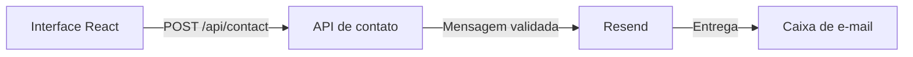

# Portfólio Terminal · Francisco Berutti

Portfólio profissional de um estudante de Engenharia de Software da PUC Minas. Apresenta minha trajetória, meus projetos acadêmicos e meus canais de contato em uma interface inspirada em terminal.

## Status do Projeto

A versão React + Vite está neste repositório. A publicação desta revisão e a entrega real de e-mails dependem da configuração do ambiente de produção.

## Índice

- [Links úteis](#links-úteis)
- [Sobre o projeto](#sobre-o-projeto)
- [Funcionalidades principais](#funcionalidades-principais)
- [Tecnologias utilizadas](#tecnologias-utilizadas)
- [Arquitetura](#arquitetura)
- [Instalação e execução](#instalação-e-execução)
- [Deploy](#deploy)
- [Estrutura de pastas](#estrutura-de-pastas)
- [Demonstração](#demonstração)
- [Testes](#testes)
- [Documentações utilizadas](#documentações-utilizadas)
- [Autores](#autores)
- [Contribuição](#contribuição)
- [Agradecimentos](#agradecimentos)
- [Licença](#licença)

## Links Úteis


- [AgroConecta no GitHub](https://github.com/ICEI-PUC-Minas-PMGES-TI/pmg-es-2026-1-ti1-0427200-agroconecta).
- [EConecta no GitHub](https://github.com/ICEI-PUC-Minas-PMGES-TI/pmg-es-2026-2-ti2-8183100-econecta).

## Sobre o Projeto

Este projeto foi desenvolvido para a disciplina de Desenvolvimento e Integração de Aplicações Web. O portfólio reúne, em um só endereço, informações que recrutadores, colegas e equipes de projeto podem consultar antes de iniciar uma conversa.

O layout combina texto claro, navegação visível e uma interface de terminal. O fundo escuro, os destaques em verde e a fonte monoespaçada preservam a identidade da primeira versão. Os itens do menu são âncoras e funcionam com teclado e toque. Em telas menores, o cabeçalho quebra em linhas e o conteúdo adota uma coluna.

## Funcionalidades Principais

- **Sobre mim.** Apresentação em português e inglês, formação, interesses, objetivos e habilidades.
- **Projetos.** Linha do tempo ordenada pela data de início, com descrição, tecnologias, repositório e captura da aplicação em execução.
- **Experiências.** Empresa Júnior e extensão universitária, com instituição, papel, período e atividades.
- **Contato.** Links para e-mail, LinkedIn, WhatsApp e GitHub. O formulário envia nome, e-mail e mensagem para o servidor.
- **Terminal.** Atalhos, histórico da sessão com as setas, preenchimento de comandos e nomes de projetos com Tab e limpeza da saída.

## Tecnologias Utilizadas

| Camada | Dependência ou ferramenta | Uso |
| --- | --- | --- |
| Front-end | `react` 19.3.1 e `react-dom` 19.3.1 | Componentes, estado e renderização |
| Interface | JavaScript, HTML e CSS | Navegação, layout responsivo, acessibilidade e validação dos campos |
| Desenvolvimento e build | `vite` 8.3.5 e `@vitejs/plugin-react` 6.1.2 | Servidor de desenvolvimento, atualização dos componentes e bundle |
| Back-end | Node.js 22.12+ e Vercel Functions | Endpoint HTTP e validação no servidor |
| E-mail | API HTTP do Resend | Encaminhamento de mensagens e endereço de resposta do visitante |
| Testes | `node:test` e `node:assert/strict` | Verificação do terminal e da API |
| Prototipação | SVG compatível com Figma | Wireframes desktop e mobile |

O projeto usa npm e Git. O back-end faz a chamada ao Resend com `fetch` nativo. A aplicação não usa banco de dados.

## Arquitetura



`src/content.js` concentra os dados de perfil, projetos e experiências. `src/commands.js` interpreta somente comandos cadastrados e entrega uma resposta estruturada aos componentes React. A linha do tempo é gerada a partir dos dados ordenados por `start`.

O formulário usa a rota `POST /api/contact`. O servidor verifica origem, tipo e tamanho do corpo, valida os campos e descarta envios com o campo oculto preenchido. A chave fica no servidor, o destinatário é fixado por configuração e o e-mail do visitante é usado como endereço de resposta. O serviço externo recebe nome, e-mail e mensagem. A interface mostra sucesso quando a API de e-mail aceita a solicitação.

A função em `api/contact.js` expõe o mesmo serviço que o middleware do Vite usa localmente.

## Instalação e Execução

### Pré-requisitos

Node.js 22.12 ou superior e npm. Para testar entrega de verdade, é preciso uma conta no Resend, uma chave autorizada a enviar e um remetente configurado para o destinatário escolhido.

### Instalação de dependências

Extraia o ZIP, abra um terminal na pasta que contém `package.json` e execute:

```sh
npm ci
npm run dev
```

Abra [http://localhost:5173](http://localhost:5173). Para conferir o bundle de produção:

```sh
npm run build
npm run preview
```

### Variáveis de Ambiente

Copie `.env.example` para `.env.local` e preencha as variáveis abaixo. Reinicie o Vite após a alteração.

| Variável | Finalidade |
| --- | --- |
| `RESEND_API_KEY` | Chave secreta com permissão de envio |
| `CONTACT_FROM` | Remetente, por exemplo `Portfolio <contato@seu-dominio.com>`, usando um domínio verificado |
| `CONTACT_TO` | Caixa que recebe as mensagens, como `fberutti@outlook.com` |

A navegação e os projetos funcionam localmente sem credenciais. Nesse caso, o formulário retorna uma mensagem de indisponibilidade e o visitante pode usar o link de e-mail.

## Deploy

Configuração para o plano Hobby da Vercel em um portfólio pessoal:

1. Crie um repositório no GitHub e envie os arquivos deste projeto da raiz, incluindo `package-lock.json` e `vercel.json`.
2. Na Vercel, importe o repositório com o preset **Vite** e Node.js compatível. O comando de build é `npm run build`, a saída é `dist` e a função de contato fica em `api/contact.js`.
3. Configure `RESEND_API_KEY`, `CONTACT_FROM` e `CONTACT_TO` no ambiente de produção e publique.
4. Abra a URL pública, confira as quatro seções, envie uma mensagem de teste autorizada e confirme a entrega na caixa de entrada. Registre a URL desta revisão em [Links úteis](#links-úteis).

## Estrutura de Pastas

```text
.
├── api/
│   └── contact.js            # Função HTTP na Vercel
├── docs/
│   ├── wireframe-desktop.svg
│   └── wireframe-mobile.svg
├── public/projects/          # Capturas das aplicações
├── server/
│   └── contact.js            # Validação e integração com Resend
├── src/
│   ├── App.jsx               # Layout, seções e navegação
│   ├── ContactForm.jsx       # Envio e feedback do formulário
│   ├── Terminal.jsx          # Prompt, histórico e saída
│   ├── commands.js           # Interpretador de comandos
│   ├── content.js            # Dados do portfólio
│   ├── main.jsx              # Entrada React
│   └── styles.css
├── test/portfolio.test.js
├── .env.example
├── index.html
├── package.json
├── package-lock.json
├── vercel.json
└── vite.config.js
```


## Testes

```sh
npm test
```

Os testes cobrem pesquisa de projetos, atalhos de contato, preenchimento de comandos, validação do formulário, destinatário fixo e resposta a falhas de configuração ou do provedor. O teste de sucesso simula a API do Resend.

## Documentações Utilizadas

- [React](https://react.dev/).
- [Vite](https://vite.dev/guide/).
- [Vercel Functions com Node.js](https://vercel.com/docs/functions/runtimes/node-js).
- [API de envio do Resend](https://resend.com/docs/api-reference/emails/send-email).
- [Modelo de README indicado na disciplina](https://github.com/joaopauloaramuni/desenvolvimento-e-integracao-de-aplicacoes-web/blob/main/TEMPLATES/template_README.md) e [versão consultada no repositório de Laboratório de Desenvolvimento de Software](https://github.com/joaopauloaramuni/laboratorio-de-desenvolvimento-de-software/blob/main/TEMPLATES/template_README.md).

## Autores

| Nome | GitHub | LinkedIn | E-mail |
| --- | --- | --- | --- |
| Francisco Berutti | [franciscoberutti](https://github.com/franciscoberutti) | [Francisco Berutti](https://www.linkedin.com/in/franciscoberutti/) | [fberutti@outlook.com](mailto:fberutti@outlook.com) |

## Contribuição

Abra uma issue com contexto e passos para reproduzir o problema. Para enviar uma alteração, crie uma branch, execute `npm test` e `npm run build` e abra um pull request descrevendo a mudança.

## Agradecimentos

À PUC Minas, pelo contexto acadêmico, e ao professor João Paulo Aramuni, pelo modelo de documentação e pela referência de navegação em terminal. [Portfólio de referência](https://github.com/joaopauloaramuni/joaopauloaramuni-portfolio).

## Licença

O portfólio está sem uma licença de distribuição declarada. Os projetos apresentados mantêm os termos de seus próprios repositórios.

